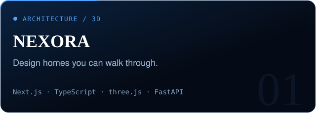
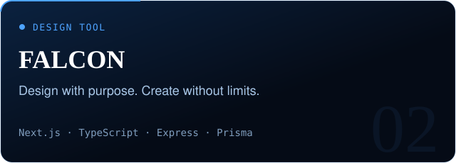
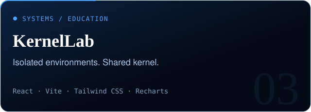
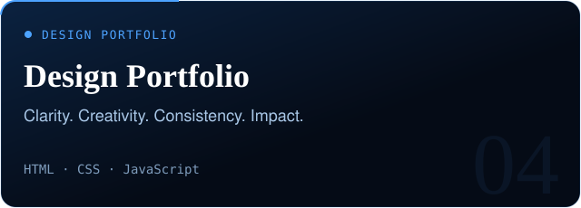

  

  
  
  
  

  

<h2 align="center">Selected work</h2>

<table>
<tr>
<td width="50%" valign="top">

<a href="https://github.com/Sumit0802-afk/NEXORA">Repository</a> &nbsp;·&nbsp; <a href="https://nexorahome.vercel.app">Live site</a>

</td>
<td width="50%" valign="top">

<a href="https://github.com/Sumit0802-afk/FALCON">Repository</a> &nbsp;·&nbsp; <a href="https://falcon-six-nu.vercel.app">Live site</a>

</td>
</tr>
<tr>
<td width="50%" valign="top">

<a href="https://github.com/Sumit0802-afk/Lightweight-Virtualization-Dashboard">Repository</a> &nbsp;·&nbsp; <a href="https://lightweight-liart.vercel.app">Live site</a>

</td>
<td width="50%" valign="top">

<a href="https://github.com/Sumit0802-afk/nexus_sumit">Repository</a> &nbsp;·&nbsp; <a href="https://nexus-sumit.vercel.app">Live site</a>

</td>
</tr>
</table>

<b>Latest in NEXORA:</b> a house design studio that restyles the 3D model from front, rear and side photos, a searchable design catalog with real 3D previews, per-object editing of walls, windows and doors, and a plot boundary wall with gates.

<h2 align="center">Toolkit</h2>

  

<h2 align="center">Contributions</h2>

  

